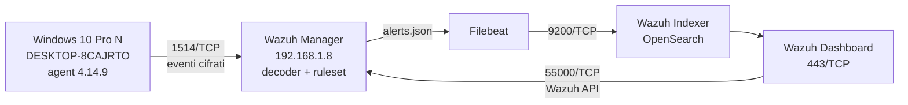
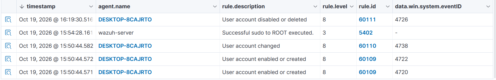

# Wazuh SOC Lab — Account Creation Detection (MITRE T1098)

> Abstract
> A Wazuh 4.14.9 SOC lab that detects local account creation and deletion on a
> Windows 10 endpoint (Windows Security events 4720/4722/4738/4726, Wazuh rules 60109/60110/60111,
> MITRE T1098), documenting the full pipeline from agent enrollment to validated alerts.
>
> It also documents the operational failures hit while building it - a full disk that
> put the indexer's indices in read-only mode and left the Wazuh API down - with the
> diagnosis and fix for each.
>
> The lab is reproducible through documented commands and VirtualBox snapshots;
> it is a learning environment, not a production deployment.

## Obiettivo

Questo laboratorio (Wazuh 4.14.9 all-in-one, Amazon Linux 2023, 4 vCPU / 6 GB)
dimostra una catena di detection completa su un comportamento usato dagli attaccanti
per la persistenza: la creazione di un account locale (evento Windows 4720, MITRE
T1098). Il valore non è l'installazione del SIEM, ma la verifica end-to-end.

Sulla VM Windows 10 Pro N (nome VM `Win10-Lab-01`, hostname `DESKTOP-8CAJRTO`) è
stato creato un account locale. L'evento 4720 è stato raccolto dall'agent Wazuh
installato sull'endpoint e inoltrato al manager, dove il ruleset lo ha mappato con
la regola 60109 (level 8). L'eliminazione dello stesso account (evento 4726) ha
generato un secondo alert con la regola 60111 (level 8). Il ruleset Wazuh mappa
entrambi gli eventi alla tecnica MITRE T1098 (Account Manipulation, Persistence).

L'ambiente è riproducibile tramite comandi documentati e snapshot VirtualBox
(`01-Base-pulita`, `02-M1-funzionante`); non è un ambiente di produzione.

## Architettura

L'evento nasce sull'endpoint, viene raccolto dall'agent e analizzato dal manager
(decoder + ruleset); gli alert vengono spediti da Filebeat all'indexer e resi
visibili nel dashboard.



## Componenti e porte

| Componente | Ruolo | Porte |
|---|---|---|
| Wazuh agent (`DESKTOP-8CAJRTO`) | raccoglie gli eventi dall'endpoint e li invia al manager | 1514/TCP in uscita |
| Wazuh Manager (`192.168.1.8`) | decodifica gli eventi, applica il ruleset e genera gli alert | 1514 eventi, 1515 enrollment, 55000 API |
| Filebeat | legge `alerts.json` e lo spedisce all'indexer | 9200/TCP in uscita |
| Wazuh Indexer | conserva e indicizza gli alert (OpenSearch) | 9200/TCP |
| Wazuh Dashboard | interfaccia web di analisi e gestione | 443/TCP |

## Setup del laboratorio

Host: VirtualBox 7.2.8 su Windows 11, 12 core logici, 16 GB di RAM.
Wazuh gira su una VM all-in-one (Amazon Linux 2023) con 4 vCPU e 6 GB di RAM.

### 1. Verifica dell'immagine

```powershell
Get-FileHash .\wazuh-4.14.9.ova -Algorithm SHA512
```

L'hash è stato confrontato con il file `.sha512` pubblicato da Wazuh e corrisponde,
quindi l'immagine è integra. Il disco virtuale della appliance è da **25 GB** — la
documentazione ne dichiara 50 — e questo va tenuto presente (vedi *Problemi
incontrati e risolti*).

### 2. Import della VM

```powershell
VBoxManage import wazuh-4.14.9.ova --vsys 0 --vmname "Wazuh-Manager" --cpus 4 --memory 6144
VBoxManage modifyvm "Wazuh-Manager" --graphicscontroller vmsvga --rtc-use-utc on
```

I due parametri finali non sono opzionali: il primo evita il blocco della finestra
della VM, il secondo evita lo sfasamento dei timestamp nei log.

### 3. Verifica dello stack

```bash
systemctl is-active wazuh-manager wazuh-indexer wazuh-dashboard filebeat
sudo /var/ossec/bin/wazuh-control status
sudo ss -tlnp | grep -E '443|1514|1515|55000|9200'
```

### 4. Hardening e punto di ripristino

Cambio delle password di default (`admin`, `wazuh-user`) e snapshot
`01-Base-pulita`, per avere un punto di ripristino prima di aggiungere endpoint.

### 5. Deploy dell'agent Windows

Su una VM Windows 10 Pro N con rete bridged (IP `192.168.1.9`), PowerShell come
amministratore:

```powershell
Set-Location $env:TEMP
Invoke-WebRequest "https://packages.wazuh.com/4.x/windows/wazuh-agent-4.14.9-1.msi" -OutFile "wazuh-agent.msi"
Start-Process msiexec.exe -ArgumentList '/i wazuh-agent.msi /q WAZUH_MANAGER="192.168.1.8"' -Wait
Start-Service wazuhsvc
```

### 6. Verifica dell'enrollment

```bash
sudo /var/ossec/bin/agent_control -l
```

L'agent deve comparire come `Active`. L'ambiente viene quindi salvato con lo
snapshot `02-M1-funzionante`.

## Evidenze: evento 4720

### Generazione dell'evento

Sull'endpoint Windows, in PowerShell come amministratore:

```powershell
net user alert-test P@ssw0rd.123 /add
```

La creazione di un account locale è una tecnica di persistenza: l'attaccante crea
un accesso che sopravvive al cambio delle credenziali originali. MITRE ATT&CK la
classifica come **T1098 – Account Manipulation** (tattica *Persistence*).

### Alert generati

| Evento Windows | Significato | Regola Wazuh | Level |
|---|---|---|---|
| **4720** | account locale creato | 60109 | 8 |
| **4722** | account abilitato | 60109 | 8 |
| **4738** | account modificato | 60110 | 8 |
| **4726** | account disabilitato o eliminato | 60111 | 8 |

Un singolo comando di creazione account produce quattro eventi distinti: quattro
punti di telemetria per un'unica azione, tutti mappati dal ruleset e correlati tra
loro tramite `agent.name` e l'intervallo temporale.




### Campi dell'alert (4720)

| Campo | Valore |
|---|---|
| `agent.name` | DESKTOP-8CAJRTO |
| `data.win.system.eventID` | 4720 |
| `rule.id` | 60109 |
| `rule.level` | 8 |
| `rule.mitre.id` | T1098 |
| `rule.mitre.tactic` | Persistence |
| `rule.mitre.technique` | Account Manipulation |

### Verifica riproducibile

L'alert è presente anche nel log del manager, non solo nel dashboard:

```bash
sudo grep -c "alert-test" /var/ossec/logs/alerts/alerts.json
```

## Hardening

Azioni applicate prima di collegare l'endpoint:

- **Cambio delle credenziali di default.** L'appliance nasce con `admin`/`admin`
  (dashboard) e `wazuh-user`/`wazuh` (sistema), identiche su ogni copia distribuita
  della OVA. Le password sono state cambiate prima di esporre la VM in rete.
- **Cambio della password `admin` tramite tool ufficiale**
  (`wazuh-passwords-tool.sh`), perché `admin` è una risorsa riservata di OpenSearch
  Security e non è modificabile dall'interfaccia (vedi *Problemi incontrati*).
- **Nessuna credenziale nel repository:** password, chiavi e token non sono
  versionati e non compaiono negli screenshot.
- **Rete:** l'endpoint Windows è in rete bridged solo per raggiungere il manager;
  le macchine di attacco (Kali, Metasploitable) saranno poste su una rete interna
  isolata, per non esporre host deliberatamente vulnerabili alla rete domestica.
- **Ambiente non produttivo e non esposto su internet.**

## Problemi incontrati e risolti

### 1. Disco pieno: indici in sola lettura e dashboard inutilizzabile

**Sintomo:** il dashboard si apriva ma diverse pagine non caricavano; i controlli
sui pattern di indice (`alerts`, `monitoring`, `statistics`) restavano rossi.

**Diagnosi:** `journalctl -u wazuh-dashboard` mostrava
`cluster_block_exception ... disk usage exceeded flood-stage watermark
(index has read-only-allow-delete block)`. `df -h` confermava `/dev/sda1` al 100%.
`du -xh --max-depth=1 /var/ossec` indicava 9,7 GB in `/var/ossec/tmp`, dove
`ls -lh` mostrava un file `vd_1.0.0_vd_4.13.0.tar` da 9,3 GB.

**Causa:** il vulnerability detector estrae periodicamente il feed CVE in un file
temporaneo che in questo caso non è stato rimosso. Al superamento della soglia
*flood-stage* (95% di occupazione) OpenSearch mette automaticamente gli indici in
sola lettura per evitare la saturazione totale del disco, bloccando la creazione
di nuovi indici.

**Soluzione:** arresto del manager (`wazuh-control stop`), rimozione del file
temporaneo, riavvio (`wazuh-control start`). Occupazione scesa al 61%: sotto la
soglia *high* (90%) il blocco di sola lettura viene rimosso automaticamente.

### 2. Wazuh API non in esecuzione: dashboard "Offline"

**Sintomo:** il dashboard mostrava la connessione API in stato `Offline` con
l'errore `Error getting the authorization token`; una chiamata diretta
all'endpoint di autenticazione restituiva `HTTP 000` (nessuna risposta).

**Diagnosi:** `ss -tlnp | grep 55000` non restituiva nulla e
`wazuh-control status | grep apid` riportava `wazuh-apid not running`.

**Causa:** conseguenza del blocco precedente: il daemon dell'API si era fermato e
non viene riavviato automaticamente come servizio indipendente.

**Soluzione:** `wazuh-control start`, che avvia solo i daemon fermi. Verifica con
`wazuh-apid is running` e ricaricando il dashboard.

### 3. Modifica della password `admin` rifiutata

**Sintomo:** il cambio password dalla dashboard restituiva
`{"status":"FORBIDDEN","message":"Resource 'admin' is reserved."}`.

**Causa:** `admin` è un utente interno riservato di OpenSearch Security:
l'API usata dall'interfaccia rifiuta la modifica delle risorse riservate.

**Soluzione:** uso del tool dedicato
`wazuh-passwords-tool.sh -u admin -p '<nuova_password>'` con percorso assoluto.
Su un'installazione all-in-one il tool aggiorna anche Filebeat e la configurazione
del dashboard. 
Verifica: login con la nuova password e assenza di errori di
autenticazione nei log di Filebeat.

## Limiti e prossimi passi

**Limiti attuali**

- Gli alert sono stati generati da **regole di default** del ruleset Wazuh
  (60109, 60110, 60111), non da regole scritte nel laboratorio.
- La rilevazione dell'evento 4720 è generica: in un ambiente reale produrrebbe
  falsi positivi (creazione di utenti da helpdesk e strumenti di gestione), da
  gestire con esclusioni mirate.
- Il disco della appliance (25 GB) limita la ritenzione dei dati.
- Il vulnerability detector è attivo e ha già generato un file temporaneo di
  9,3 GB: su questo disco va monitorato o disabilitato.

**Prossimi passi**

- Regole di detection proprie, con test e note sui falsi positivi.
- Sysmon sull'endpoint e simulazione di tecniche di attacco per validare le regole.
- Rilevamento e blocco automatico di brute force SSH (Active Response).
- Tool di triage phishing e generazione automatica di report.


