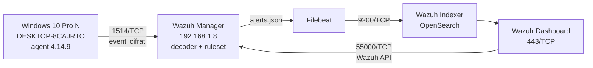

# Wazuh SOC Lab — Account Creation Detection (MITRE T1098)

> Abstract
> A Wazuh 4.14.9 SOC lab that detects local account creation and deletion on a
> Windows 10 endpoint (Windows Security events 4720/4726, Wazuh rules 60109/60111,
> MITRE T1098), documenting the full pipeline from agent enrollment to validated alerts.
>
> It also documents the operational failures hit while building it a full disk that
> put the indexer's indices in read-only mode and left the Wazuh API down with the
> diagnosis and fix for each.
>
> The lab is reproducible through documented commands and VirtualBox snapshots;
> it is a learning environment, not a production deployment.

## Obiettivo

Questo laboratorio (Wazuh 4.14.9 all-in-one, Amazon Linux 2023, 4 vCPU / 6 GB)
dimostra una catena di detection completa su un comportamento usato dagli attaccanti
per la persistenza: la creazione di un account locale (evento Windows 4720, MITRE
T1098). Il valore non è l'installazione del SIEM, ma la verifica end-to-end.

Sulla VM Windows 10 Pro N (nome VM `Win10-Lab-01`, hostname `DESKTOP-8CAJRTO`) è
stato creato un account locale. L'evento 4720 è stato raccolto dall'agent Wazuh
installato sull'endpoint e inoltrato al manager, dove il ruleset lo ha mappato con
la regola 60109 (level 8). L'eliminazione dello stesso account (evento 4726) ha
generato un secondo alert con la regola 60111 (level 8). Il ruleset Wazuh mappa
entrambi gli eventi alla tecnica MITRE T1098 (Account Manipulation, Persistence).

L'ambiente è riproducibile tramite comandi documentati e snapshot VirtualBox
(`01-Base-pulita`, `02-M1-funzionante`); non è un ambiente di produzione.

## Architettura
L'evento nasce sull'endpoint, viene raccolto dall'agent e analizzato dal manager
(decoder + ruleset); gli alert vengono spediti da Filebeat all'indexer e resi
visibili nel dashboard.

## Componenti e porte

## Setup del laboratorio

## Evidenze: evento 4720

## Hardening

## Problemi incontrati e risolti
### 1. Disco pieno: indici in sola lettura e dashboard inutilizzabile

**Sintomo:** il dashboard si apriva ma diverse pagine non caricavano; i controlli
sui pattern di indice (`alerts`, `monitoring`, `statistics`) restavano rossi.

**Diagnosi:** `journalctl -u wazuh-dashboard` mostrava
`cluster_block_exception ... disk usage exceeded flood-stage watermark
(index has read-only-allow-delete block)`. `df -h` confermava `/dev/sda1` al 100%.
`du -xh --max-depth=1 /var/ossec` indicava 9,7 GB in `/var/ossec/tmp`, dove
`ls -lh` mostrava un file `vd_1.0.0_vd_4.13.0.tar` da 9,3 GB.

**Causa:** il vulnerability detector estrae periodicamente il feed CVE in un file
temporaneo che in questo caso non è stato rimosso. Al superamento della soglia
*flood-stage* (95% di occupazione) OpenSearch mette automaticamente gli indici in
sola lettura per evitare la saturazione totale del disco, bloccando la creazione
di nuovi indici.

**Soluzione:** arresto del manager (`wazuh-control stop`), rimozione del file
temporaneo, riavvio (`wazuh-control start`). Occupazione scesa al 61%: sotto la
soglia *high* (90%) il blocco di sola lettura viene rimosso automaticamente.

### 2. Wazuh API non in esecuzione: dashboard "Offline"

**Sintomo:** il dashboard mostrava la connessione API in stato `Offline` con
l'errore `Error getting the authorization token`; una chiamata diretta
all'endpoint di autenticazione restituiva `HTTP 000` (nessuna risposta).

**Diagnosi:** `ss -tlnp | grep 55000` non restituiva nulla e
`wazuh-control status | grep apid` riportava `wazuh-apid not running`.

**Causa:** conseguenza del blocco precedente: il daemon dell'API si era fermato e
non viene riavviato automaticamente come servizio indipendente.

**Soluzione:** `wazuh-control start`, che avvia solo i daemon fermi. Verifica con
`wazuh-apid is running` e ricaricando il dashboard.

### 3. Modifica della password `admin` rifiutata

**Sintomo:** il cambio password dalla dashboard restituiva
`{"status":"FORBIDDEN","message":"Resource 'admin' is reserved."}`.

**Causa:** `admin` è un utente interno riservato di OpenSearch Security:
l'API usata dall'interfaccia rifiuta la modifica delle risorse riservate.

**Soluzione:** uso del tool dedicato
`wazuh-passwords-tool.sh -u admin -p '<nuova_password>'` con percorso assoluto.
Su un'installazione all-in-one il tool aggiorna anche Filebeat e la configurazione
del dashboard. 
Verifica: login con la nuova password e assenza di errori di
autenticazione nei log di Filebeat.

## Limiti e prossimi passi

